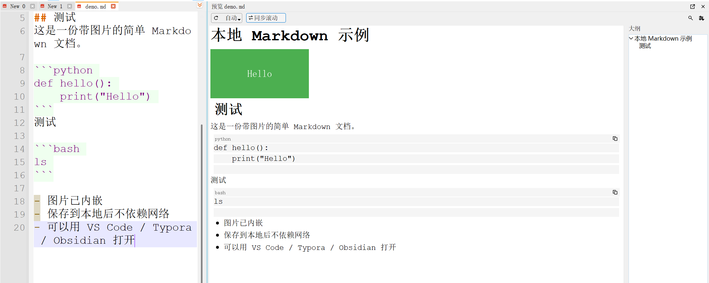
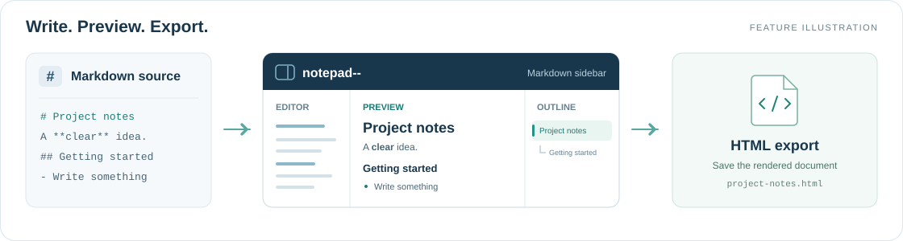
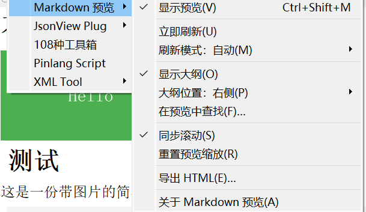

# markdownview--

**在 notepad-- 中，一边写 Markdown，一边看预览。**

markdownview-- 是 [notepad--](https://gitee.com/cxasm/notepad--) 的 Markdown 侧栏预览插件。它将编辑器原生的 Markdown 预览融入同一个窗口，提供标题大纲、同步滚动、预览内搜索、代码块复制和 HTML 导出，让写作与阅读连在一起。

适用于 **notepad-- v3.8.3 · Windows x64**，采用 **GPL-3.0-or-later** 许可。

[下载插件](https://github.com/jiy29104983/markdownviewdd/releases) · [v0.2.10 版本说明](docs/releases/v0.2.10.md) · [使用指南](docs/usage.md) · [问题反馈](https://github.com/jiy29104983/markdownviewdd/issues)

[](docs/images/markdown-preview.png)

*实际界面：左侧编辑 Markdown，右侧查看正文、图片、代码块和标题大纲。点击截图可查看原图。*

## 功能亮点

- **边写边看**：自动跟随当前 Markdown 标签页，在输入停顿后更新；也可切换手动刷新，专注阅读。
- **灵活布局**：预览可停靠在编辑器左侧或右侧，也可作为浮动窗口使用。
- **大纲导航**：展示 H1～H6 标题层级；预览已更新且标题可定位时，点击大纲可让源码与预览一起跳转。
- **同步滚动**：按阅读进度联动编辑区与预览区，也可关闭同步，独立浏览两侧内容。
- **预览内搜索**：支持区分大小写、命中计数、高亮及前后跳转。
- **代码块工具**：显示语言标识，一键复制完整代码，支持切换长行自动换行。
- **舒适阅读**：跟随编辑器明暗配色和已保存的 Markdown 正文字体，支持临时缩放。
- **HTML 导出**：导出当前文档的最新预览，将可读取的本地图片嵌入单个 HTML 文件，方便分享。



支持的文件扩展名：`.md`、`.markdown`、`.mdown`、`.mkd`、`.mkdn`、`.mdwn`。

## 安装与开始使用

### 运行要求

| 项目 | 要求 |
| --- | --- |
| 编辑器 | notepad-- v3.8.3 插件版，x64 |
| 操作系统 | Windows 10、Windows 11，或带桌面体验的 Windows Server 2016 |
| 运行库 | 使用 notepad-- 安装目录自带的 Qt 5.15.2，无需另行安装 Qt 开发环境 |

### 安装插件

1. 前往 [Releases](https://github.com/jiy29104983/markdownviewdd/releases)，下载 Windows x64 的 ZIP 发布包。
2. 关闭 notepad--，解压发布包。
3. 将包内的 `plugin/markdownviewdd.dll` 复制到 `Notepad--.exe` 同级的 `plugin` 目录；若旧版本留下了 `markdownview.dll`，请先移除该旧文件。
4. 重新启动 notepad--，打开一个 Markdown 文件。
5. 按 `Ctrl+Shift+M`，或选择 **插件 → Markdown 预览 → 显示预览**，打开预览侧栏。

安装后的目录结构如下：

```text
Notepad--/
├── Notepad--.exe
└── plugin/
    └── markdownviewdd.dll
```

发布包同时提供 SHA256 校验文件，校验方法见[版本说明](docs/releases/v0.2.10.md)。图片与完整文档可在[项目主页](https://github.com/jiy29104983/markdownviewdd#readme)在线查看。

## 常用操作

插件菜单集中提供刷新、大纲、查找、同步滚动、缩放重置和导出入口；常用功能也可直接在预览工具栏操作。

[](docs/images/markdown-preview-menu.png)

| 操作 | 使用方式 |
| --- | --- |
| 显示／隐藏预览 | `Ctrl+Shift+M`，或插件菜单中的“显示预览” |
| 从编辑区打开预览 | 右键菜单中的“在侧边栏预览 Markdown” |
| 刷新内容 | 工具栏刷新按钮，或插件菜单中的“立即刷新” |
| 切换自动／手动刷新 | 工具栏的刷新模式菜单，或插件菜单中的“刷新模式” |
| 定位章节 | 点击大纲标题，或用方向键选择后按 `Enter` |
| 查找预览内容 | 在预览内按 `Ctrl+F`；`Enter`／`Shift+Enter` 跳转，`Esc` 关闭搜索 |
| 复制代码块 | 点击代码块右上角的复制按钮，或在代码内使用右键菜单 |
| 调整预览字号 | 在预览内按住 `Ctrl` 并滚动鼠标；“重置预览缩放”恢复基准字号 |
| 导出 HTML | 插件菜单中的“导出 HTML” |

默认使用自动刷新。手动模式下，修改源码后点击“立即刷新”即可更新预览；状态栏会提示当前内容是否需要刷新。布局、字体、图片与导出的详细说明见[使用指南](docs/usage.md)。

## 兼容性与限制

- 当前适配基线为 **notepad-- v3.8.3 x64**；其他版本的兼容性请参阅[宿主兼容性说明](docs/host-compatibility.md)。
- 预览沿用 Qt 5.15 的 Markdown 渲染，不支持 Mermaid、数学公式、JavaScript 和复杂网页样式。
- 连续滚动同步按两侧滚动位置的比例估算；复杂标题可能只支持在预览内定位。
- 大文件或渲染较慢时，插件会暂停后续自动刷新，可通过“立即刷新”更新内容。
- 尚未刷新的预览仍可阅读、查找和复制；同步滚动会等待刷新成功后恢复。
- HTML 导出会嵌入可读取的本地图片；远程图片保留原地址，普通链接指向的本地文件不会自动打包。

## 从源码构建

准备以下 Windows 构建环境：

- Visual Studio 2019 或 Build Tools 2019，安装 **MSVC v142 x64** 工具集。
- **Qt 5.15.2 `msvc2019_64`**（含 Qt Test 模块）。
- **CMake 3.16+**。

下载源码后，在仓库根目录运行 `build-windows.bat`。脚本默认使用 `C:\Qt\5.15.2\msvc2019_64`；也可以在 PowerShell 中指定 Qt 路径：

```powershell
.\scripts\build-windows.ps1 -QtRoot "D:\Qt\5.15.2\msvc2019_64"
```

构建产物为 `build\plugin\markdownviewdd.dll`，按上文步骤安装即可。手动 CMake、qmake 和 Visual Studio 2022 的构建方法见[构建指南](docs/building.md)。

## 参与贡献

欢迎通过 [Issues](https://github.com/jiy29104983/markdownviewdd/issues) 提交问题和建议，或通过 Pull Request 改进代码与文档。反馈问题时，请附上插件版本、notepad-- 版本、Windows 版本和复现步骤；涉及显示问题时，可附上截图和最小 Markdown 示例。

| 文档 | 内容 |
| --- | --- |
| [使用指南](docs/usage.md) | 刷新模式、大纲、搜索、代码块、字体与 HTML 导出 |
| [构建指南](docs/building.md) | Windows 构建依赖、脚本与手动构建命令 |
| [架构说明](docs/architecture.md) | 插件结构与宿主集成方式 |
| [测试指南](docs/testing.md) | 回归测试命令与真实宿主检查步骤 |
| [宿主兼容性](docs/host-compatibility.md) | 适配版本与接口约束 |
| [发布指南](docs/releasing.md) | GitHub Actions 构建、打包与发布流程 |

提交功能修改前，请运行[测试指南](docs/testing.md)中的相关检查，并在目标 notepad-- 版本中验证实际效果。

## 许可证

本项目采用 [GNU GPL v3.0 or later](LICENSE) 许可。感谢 [notepad--](https://gitee.com/cxasm/notepad--) 提供编辑器与原生 Markdown 渲染能力。
